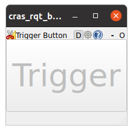
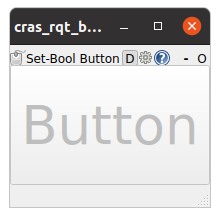
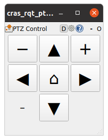
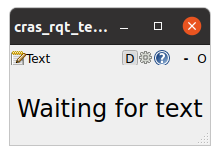

# RQt plugins for CRAS robots

<!--
SPDX-License-Identifier: BSD-3-Clause
SPDX-FileCopyrightText: Czech Technical University in Prague
-->

This repository holds ROS 2 packages with custom RQt plugins:

- [cras_rqt_common](cras_rqt_common/README.md): immutable colors, the settings fields, settings dialog, widget and
  plugin bases.
- [cras_rqt_ptz_control](cras_rqt_ptz_control/README.md): a touch-friendly D-pad to steer a PTZ gimbal-camera by
  relative motions and velocities.
- [cras_rqt_text](cras_rqt_text/README.md): a widget showing a text coming from a `std_msgs/String` or
  `rviz_2d_overlay_msgs/OverlayText` topic, with the markup in the text interpreted.
- [cras_rqt_buttons](cras_rqt_buttons/README.md): large touch-friendly buttons calling `std_srvs/Empty`,
  `std_srvs/Trigger` and `std_srvs/SetBool` services.

The plugins are picked up by RQt under *Plugins*, each in the group its package announces, and every one of them can
also be started as a program of its own, e.g. `ros2 run cras_rqt_buttons empty_button` or
`ros2 launch cras_rqt_text text.launch.py`. However they are started, their settings are offered by the configuration
dialog of the plugin, saved with the RQt perspective, and can be given on the command line as options named after
them, which then win over what was saved before.






## Building

Source your ROS 2 distribution and call

```
colcon build --packages-up-to cras_rqt_buttons cras_rqt_text cras_rqt_ptz_control
```

in the root of your workspace (the folder that contains the `src` directory). `--packages-up-to` builds the plugin
together with `cras_rqt_common`, which every plugin needs; name a single package instead to build only that one. The
text plugin additionally wants `rviz_2d_overlay_msgs` installed to be able to listen to `OverlayText` topics at all.
When RQt does not offer a freshly built plugin, let it scan the plugins again with `rqt --force-discover`.

## Tests

The tests of all four packages run with `colcon test` in the workspace; a single package can also be tested directly,
with the workspace sourced and no display around:

```
QT_QPA_PLATFORM=offscreen python3 -m pytest cras_rqt_common/test cras_rqt_text/test
```

## License

BSD 3-Clause, see [LICENSE](LICENSE) and the license notice of each package.
